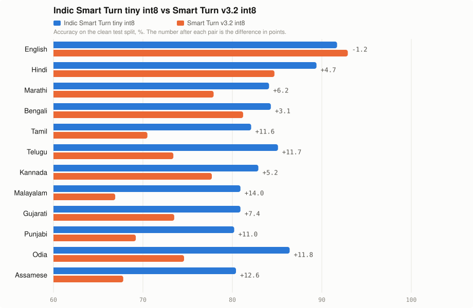
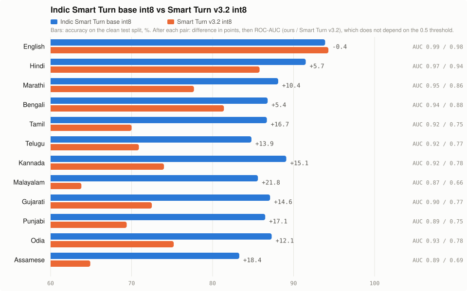
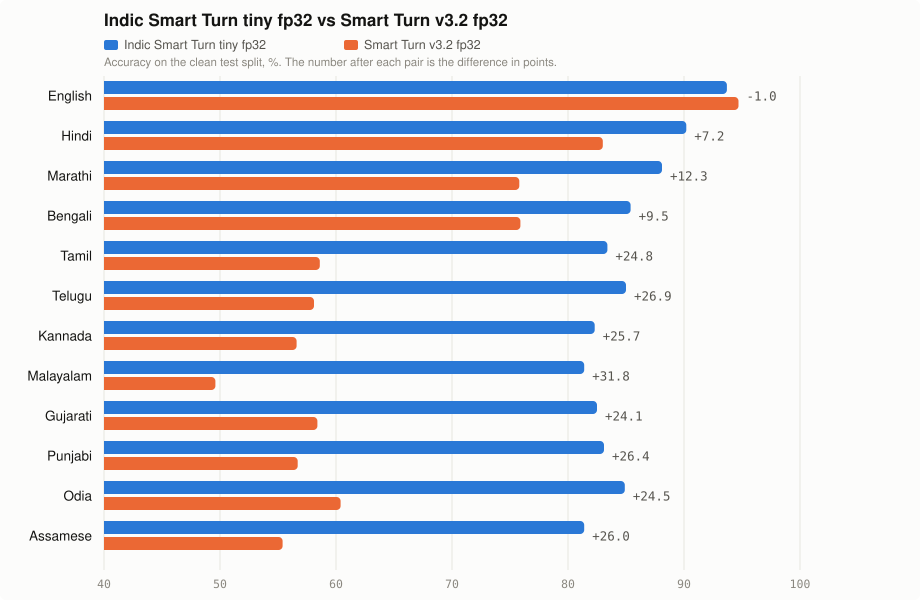
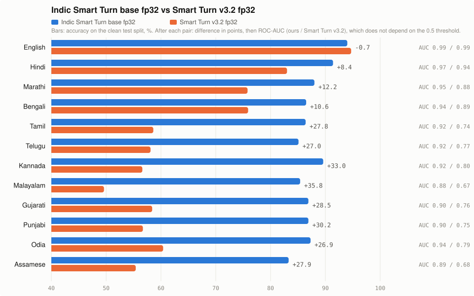

# Indic Smart Turn

End-of-turn detection for English and eleven Indian languages: Hindi, Marathi, Bengali, Tamil, Telugu, Kannada, Malayalam, Gujarati, Punjabi, Odia and Assamese. A voice agent has to decide at every pause whether the user has finished speaking. Indic Smart Turn makes that decision from the audio alone and runs on one CPU core in under 50 ms.

It is built with the [Pipecat Smart Turn v3](https://github.com/pipecat-ai/smart-turn) recipe from Whisper weights and trained mostly on real Indian phone conversations from IndicVoices and TamilEOT, plus Pipecat's own data. It loads in Pipecat's `LocalSmartTurnAnalyzerV3` with a one-line change.

- **Models:** [adimyth/indic-smart-turn](https://huggingface.co/adimyth/indic-smart-turn)
- **Data:** [adimyth/indic-smart-turn-data](https://huggingface.co/datasets/adimyth/indic-smart-turn-data)
- **Release post:** [Building Indic Smart Turn](https://adimyth.in/essays/building-indic-smart-turn)

<video src="https://huggingface.co/adimyth/indic-smart-turn/resolve/main/pause-test.mp4" controls muted width="100%"></video>

## Results

Accuracy at the 0.5 threshold on the same speaker-disjoint test clips, with ROC-AUC at the end of each row. Smart Turn v3.2 ships as a whisper-tiny in two files, int8 for CPU and fp32 for GPU, so each group compares with the v3.2 file of the same precision.

### Tiny int8 vs Smart Turn v3.2 int8

Same encoder size, precision and speed as the shipped CPU file.

<picture>
  <source media="(prefers-color-scheme: dark)" srcset="docs/figures/group1_tiny_int8-dark.svg">
  
</picture>

### Base int8 vs Smart Turn v3.2 int8

<picture>
  <source media="(prefers-color-scheme: dark)" srcset="docs/figures/group2_base_int8-dark.svg">
  
</picture>

### Tiny fp32 vs Smart Turn v3.2 fp32

<picture>
  <source media="(prefers-color-scheme: dark)" srcset="docs/figures/group3_tiny_fp32-dark.svg">
  
</picture>

### Base fp32 vs Smart Turn v3.2 fp32

On the human-validated TamilEOT test it scores 85.9%, close to the paper's whisper-base result of 86.1%.

<picture>
  <source media="(prefers-color-scheme: dark)" srcset="docs/figures/group4_base_fp32-dark.svg">
  
</picture>

int8 results differ slightly between CPU architectures while fp32 results do not, so each int8 chart pairs models scored on one machine. Details: [`docs/int8_cpu_dependence.md`](docs/int8_cpu_dependence.md).

## How to use it

Four files on Hugging Face:

- `indic-smart-turn-base-int8.onnx`, recommended on x86 servers
- `indic-smart-turn-base-fp32.onnx`, for Apple Silicon and GPUs
- `indic-smart-turn-tiny-int8.onnx`
- `indic-smart-turn-tiny-fp32.onnx`

All take the same input as Smart Turn v3, 8 s of 16 kHz audio as an 80 x 800 log-mel, and return the probability that the turn is complete.

### Pipecat

```python
from pipecat.audio.turn.smart_turn.local_smart_turn_v3 import LocalSmartTurnAnalyzerV3

analyzer = LocalSmartTurnAnalyzerV3(smart_turn_model_path="indic-smart-turn-base-int8.onnx")
```


### Directly

The model takes an 80 x 800 log-mel of the last 8 seconds of 16 kHz mono audio and returns the probability that the turn is complete. `config.json` records the same contract.

Single clip:

```python
import numpy as np, onnxruntime as ort, soundfile as sf
from transformers import WhisperFeatureExtractor

MODEL = "indic-smart-turn-base-int8.onnx"
fe = WhisperFeatureExtractor(chunk_length=8)           # 8 s window, 80 mel bins, 800 frames
so = ort.SessionOptions(); so.intra_op_num_threads = 1  # one core is enough at batch 1
session = ort.InferenceSession(MODEL, so, providers=["CPUExecutionProvider"])

def last_8s(audio: np.ndarray, sr: int = 16000) -> np.ndarray:
    n = 8 * sr
    return audio[-n:] if len(audio) > n else np.pad(audio, (n - len(audio), 0))  # keep the end, zero-pad the front

def turn_complete_prob(audio: np.ndarray) -> float:
    feats = fe(last_8s(audio), sampling_rate=16000, return_tensors="np", padding="max_length",
               max_length=8 * 16000, truncation=True, do_normalize=True).input_features.astype(np.float32)
    return float(session.run(None, {"input_features": feats})[0][0, 0])

audio, sr = sf.read("clip.wav", dtype="float32")        # 16 kHz mono; resample first if not
p = turn_complete_prob(audio)
print("complete" if p > 0.5 else "incomplete", round(p, 3))
```

## License and attribution

- **Code and models: BSD 2-Clause** (`LICENSE`), the same license as Pipecat Smart Turn. The files under `train/` are derived from Pipecat's trainer and keep its copyright notice (`train/LICENSE.pipecat`).
- **Dataset `adimyth/indic-smart-turn-data`: CC BY 4.0**, because its audio comes from IndicVoices, which is CC BY 4.0. Credit AI4Bharat when you use it.
- [Pipecat Smart Turn v3](https://github.com/pipecat-ai/smart-turn) by Pipecat / Daily: architecture, trainer and the v3.2 training data (CC BY 4.0).
- [ai4bharat/IndicVoices](https://huggingface.co/datasets/ai4bharat/IndicVoices) by AI4Bharat: conversational audio (CC BY 4.0).
- [santhosh-005/tamil-eot](https://huggingface.co/datasets/santhosh-005/tamil-eot): Tamil turn boundaries and the recipe this project follows (CC BY 4.0).
